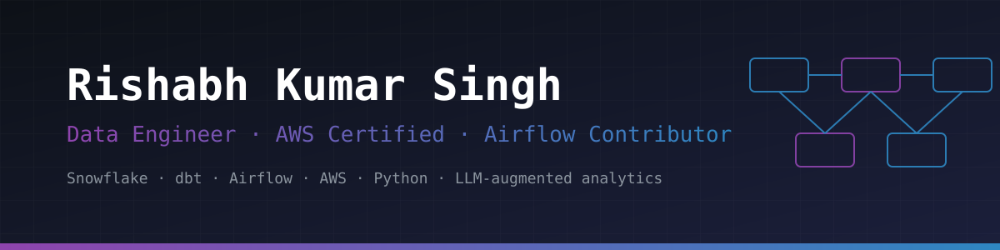
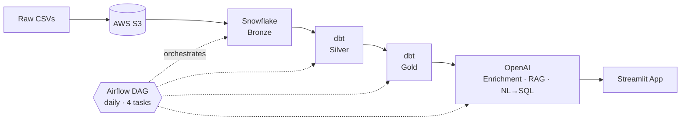

<div align="center">




<br/>

[](https://linkedin.com/in/Rishabh0b)
[](https://x.com/Rishabh_0b)
[](mailto:Rishabh00b@gmail.com)


</div>

---

## `whoami`

```yaml
name:        Rishabh Kumar Singh
role:        Data Engineer (student) — pipelines, warehousing, AI-augmented analytics
education:   B.Tech CSE (AI), KIET Group of Institutions · 2024 → 2028
location:    Delhi, India
certified:   AWS Certified Data Engineer – Associate (DEA-C01)
open_source: Apache Airflow contributor — 2 merged PRs
stack:       [Snowflake, dbt, Airflow, AWS, Python, SQL, Docker]
learning:    [Apache Spark, System Design, Advanced dbt + CI/CD]
status:      Open to Data Engineering / Analytics / Cloud internships
```

I build batch data platforms the way production teams do: layered models, tested transformations, orchestrated and containerised, with an AI layer on top for people who don't write SQL.

🌐 **Open-source contributor to [Apache Airflow](https://github.com/apache/airflow)** — 2 pull requests merged into the orchestrator behind my own pipelines.

---

## 🏆 Highlights

| | |
|:--|:--|
| 🌐 **Open Source** | **2 merged PRs in [Apache Airflow](https://github.com/apache/airflow)** |
| ☁️ **Certified** | AWS Certified Data Engineer – Associate (DEA-C01) and Cloud Practitioner (CLF-C02) |
| 📦 **Scale** | Pipeline handling **10M+ orders · 23M+ order items · 300K+ reviews** |
| 🤖 **AI on the warehouse** | LLM review enrichment, RAG review chat, and NL→SQL with a SELECT-only guard |
| 🥇 **Leadership** | 1st Prize, InnoTech Tech Fest — led the ZeroMile logistics concept |
| 🧪 **Industry exposure** | Software QA Engineering intern at FabHotels |

---

## 🚀 Featured Project — Zomato Data Engineering & AI Platform

**`Python` `AWS S3` `Snowflake` `dbt` `Apache Airflow` `Docker` `OpenAI` `Streamlit`**

A production-style batch platform that takes raw CSVs to AI-powered analytics.



| Area | What it does |
|:--|:--|
| **Architecture** | Medallion (Bronze → Silver → Gold), 15+ dbt models |
| **Loading** | Incremental `MERGE`, SCD Type 2 snapshot |
| **Quality** | Automated dbt tests across every layer |
| **Orchestration** | Daily 4-task Airflow DAG, fully Dockerized |
| **AI layer** | LLM review enrichment · RAG review chat · NL→SQL with SELECT-only safety guard |

[**→ View Repository**](https://github.com/Rishabh00b/zomato-end-to-end-data-engineering)

---

## 🌐 Open Source — Apache Airflow

[](https://github.com/apache/airflow/pulls?q=is%3Apr+author%3ARishabh00b+is%3Amerged)


I contribute to [Apache Airflow](https://github.com/apache/airflow), the workflow orchestrator I use daily in my own data pipelines. Two of my pull requests have been reviewed by maintainers and merged upstream.

[**→ See my merged pull requests**](https://github.com/apache/airflow/pulls?q=is%3Apr+author%3ARishabh00b+is%3Amerged)

---

## 🧩 More Projects

| Project | Stack | Summary |
|:--|:--|:--|
| 📊 **Sales Data Analysis Dashboard** | `Python` `SQL` `Pandas` `Power BI` | ETL workflow for raw sales data, with Power BI dashboards for KPIs, revenue trends and regional performance. |
| 👨‍🏫 **Teacher Data Management System** | `Java` `Spring Boot` `MySQL` | REST APIs over a normalized relational schema with a query-optimized backend. |
| 🚚 **ZeroMile** — *1st Prize, InnoTech Fest* | `Logistics` `Team Leadership` | Led a team to design a marketplace matching shippers with trucks on return routes, cutting empty trips and costs. [Repo](https://github.com/kastwaru/ZeroMile) |

---

## 🏅 Certifications

| Certification | Issuer | Level |
|:--|:--|:--:|
| **AWS Certified Data Engineer – Associate** (DEA-C01) | Amazon Web Services | Associate |
| **AWS Certified Cloud Practitioner** (CLF-C02) | Amazon Web Services | Foundational |
| Data Analytics Job Simulation | Deloitte × Forage | Simulation |
| Machine Learning Foundations | AWS Academy | Foundational |
| AI for Everyone | DeepLearning.AI | Foundational |

---

## 🛠️ Tech Stack

<div align="center">

**Data Engineering & Warehousing**<br/>


**Cloud**<br/>


**Languages & Data**<br/>


**AI / LLM**<br/>


**Backend & Tools**<br/>


</div>

---

## 🗺️ Roadmap

- [x] Medallion pipeline with Snowflake, dbt and Airflow
- [x] AWS Certified Data Engineer – Associate
- [x] LLM layer on a real warehouse (RAG + NL→SQL)
- [x] First contributions merged into Apache Airflow
- [ ] Keep contributing upstream — deeper core / provider work
- [ ] Apache Spark / PySpark for large-scale processing
- [ ] dbt CI/CD (slim CI, state-based runs, automated docs)
- [ ] System design for data platforms (streaming, lakehouse patterns)

---

## 📈 GitHub Analytics

<div align="center">


</div>

---

## 📬 Let's Connect

Open to **Data Engineering, Data Analyst and Cloud internships**, and to collaborating on pipelines, warehouses or AI-augmented analytics. Happy to talk AWS, dbt, Airflow, Snowflake, or anything data.

<div align="center">

[](mailto:Rishabh00b@gmail.com)
[](https://linkedin.com/in/Rishabh0b)
[](https://x.com/Rishabh_0b)

*Turning raw, messy data into pipelines people can trust.*


</div>
